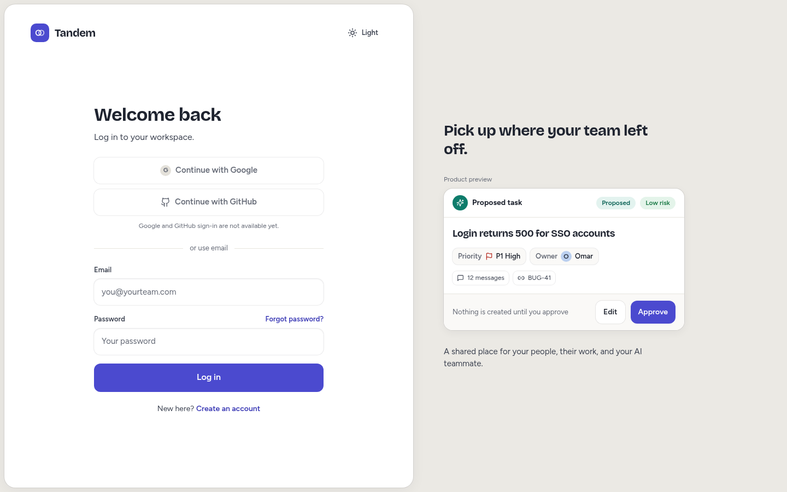
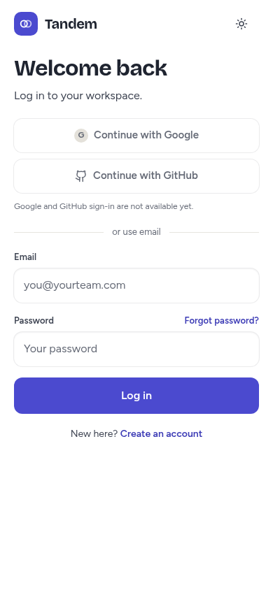
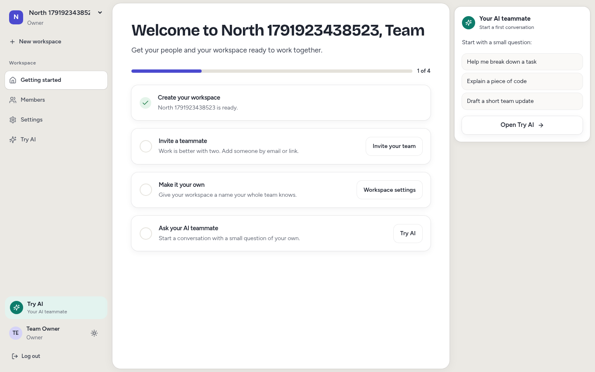
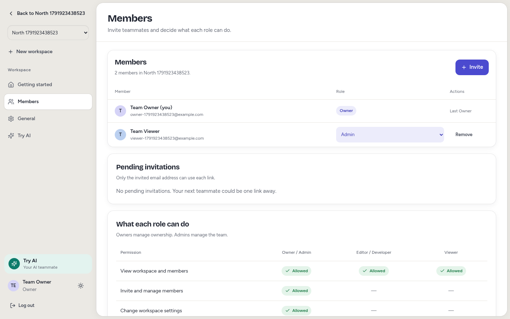
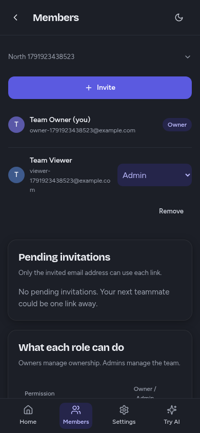
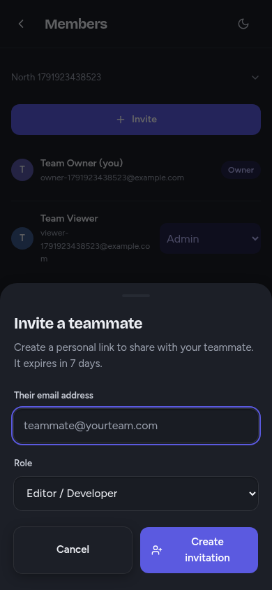

# Frontend design and localhost startup

The auth and workspace frontend now follows the uploaded **Workspace UI UX - Web + Mobile.html** design. The app remains connected to the existing FastAPI API and PostgreSQL database. Work continues on `v1`.

## Design reference

The uploaded file contains 39 bundled screens. Its HTML templates and embedded font resources were extracted locally for visual comparison, without running the bundle's scripts in the application. The uploaded canvas supplies the layout and visual reference; the existing PRD continues to define implemented product scope.

| Canvas screens | Result |
| --- | --- |
| Log in; Mobile log in | Form on the left, story on the right, linked-circle logo, original heading, 420 px form, labeled email/password controls, mobile spacing |
| Sign up; Forgot password | Same auth shell, signup feature list, reset acknowledgement after a real API response |
| Accept invitation | Centered 480 px card with actual workspace, role, invited email, account switching and acceptance |
| Getting started | Workspace sidebar, rounded main panel, checklist/progress and optional AI panel |
| General | Settings header, workspace card, logo initial, editable name, cancel/save actions and ownership link |
| Members and roles; Mobile members | Members card, colored initials, real roles, invitation controls, role matrix, compact mobile rows |
| Mobile sheets | Invitation and removal dialogs use bottom sheets with focus trapping, Escape, focus return and safe-area padding |

The colors, Figtree/Bricolage Grotesque/JetBrains Mono fonts, white panels, warm sidebar, teal agent styling, indigo controls, card shadows and rounded corners use the supplied design tokens in both themes. The tab bar and workspace menu provide access to the implemented screens on mobile.

## Behavior and corrections

- Registration, login, reset, workspace creation/switching, invitations, roles and settings continue to use real API requests.
- Invite now opens a dialog on desktop and a bottom sheet on mobile. Its generated link remains available to copy before closing.
- Renew link uses the existing invitation API, invalidates the previous link and presents the replacement. It does not claim an email was sent.
- The pending invitation section excludes accepted/revoked invitations.
- Workspace setup progress reflects an existing workspace, joined teammates, a saved name and successful AI trial history. The saved-name checkpoint is local to the current browser/user/workspace; it is not a new server onboarding record.
- Workspace renaming previously remounted the settings form and cleared its success acknowledgement. Keeping the component keyed by workspace ID preserves that acknowledgement and focus.
- Dialog focus returns to the control that opened it. Mobile controls use touch-sized targets, 16 px inputs, scrollable sheets and contained table overflow.
- The screenshot capture before auth hydration preserves caret styling so the browser test does not modify React's initial DOM and trigger a hydration warning.

## Scope and deliberate differences

The canvas contains future messaging, tasks, documents, shared-agent approvals, memory, billing, OAuth and marketing screens. This update matches the implemented foundation/auth/workspace screens and retains the separately authorized AI trials. It does not implement those future backend features.

Google/GitHub buttons are visibly unavailable; email authentication works. The login-side proposal is labeled **Product preview**, with decorative actions. Prices, seat limits, fabricated online/last-active statuses, unsupported settings fields, legal agreement controls and an optional persistent-session checkbox are not presented as working features. Actual membership permissions and the existing session policy remain authoritative. Workspace and member content comes from the database rather than the canvas's sample names and counts.

## Localhost on your computer

Your Codex desktop project is a separate checkout from this cloud machine. In a **Local** task or terminal in that checkout, update `v1`, install Node.js 24 and ensure Docker Desktop is running, then run:

```bash
node infra/dev.mjs
```

The launcher:

1. Checks that port 3000 is available or serves Tandem.
2. Preserves an existing `.env`, or creates random development database/JWT secrets in an ignored file. It never prints credentials.
3. Installs frontend dependencies from the lockfile and starts the Docker database/backend with migrations and health checks.
4. Starts Next.js on loopback, verifies the login page and proxied API, then opens `http://localhost:3000/login` in the computer's browser.

Keep the terminal open. Ctrl+C stops only the frontend it started; database data remains. Repeated runs refresh the backend and reuse a running frontend. Another app on port 3000 is left untouched. The launcher diagnoses incompatible origin/secure-cookie settings without overwriting them. `--no-open` skips browser opening and `--skip-install` reuses installed dependencies.

Local provider keys must be supplied securely in that computer's ignored `.env`. Cloud keys are not copied to your PC or Git. This cloud task cannot execute commands on your Windows computer or prove its browser has opened. The Windows command/browser paths are implemented; native Windows execution remains unverified here.

## Verification

| Check | Actual result |
| --- | --- |
| `npm run lint` | Passed |
| `npm run typecheck` | Passed |
| `npm test` | 17 tests passed in 3 files |
| `npm run build` | Passed, 13 generated routes including the app icon |
| `PLAYWRIGHT_CHROMIUM_EXECUTABLE=/usr/bin/chromium npm run test:e2e` | 2 browser tests passed against the production build |
| Browser flow coverage | Two users, signup, workspace creation/switching, invite renewal and rejection of the old token, acceptance, role changes, Viewer restrictions, settings save and setup progress |
| Mobile coverage | 390 px portrait, 844 × 390 login landscape, dark theme, no page overflow, usable input sizes, invitation sheet autofocus/Escape/focus return |
| `node --check infra/dev.mjs` | Passed |
| Launcher startup | Started the frontend against the real backend using `--cloud --skip-install --no-open` |
| Launcher recovery/reuse | Restarted the stopped backend while preserving/reusing a running frontend; repeated startup succeeded |
| Production login | Loaded at desktop/mobile sizes with zero browser page errors |

No backend code, schema, provider adapters or provider keys were changed. Browser tests use synthetic users and no paid AI generation. Native-device keyboard behavior and Windows execution have not been tested in this Linux cloud environment. Remote GitHub Actions status is not asserted.

## Real application screenshots

Captured from the rebuilt production app with synthetic test accounts:







